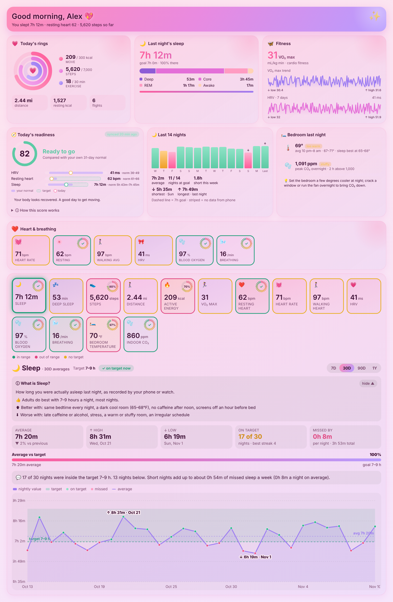
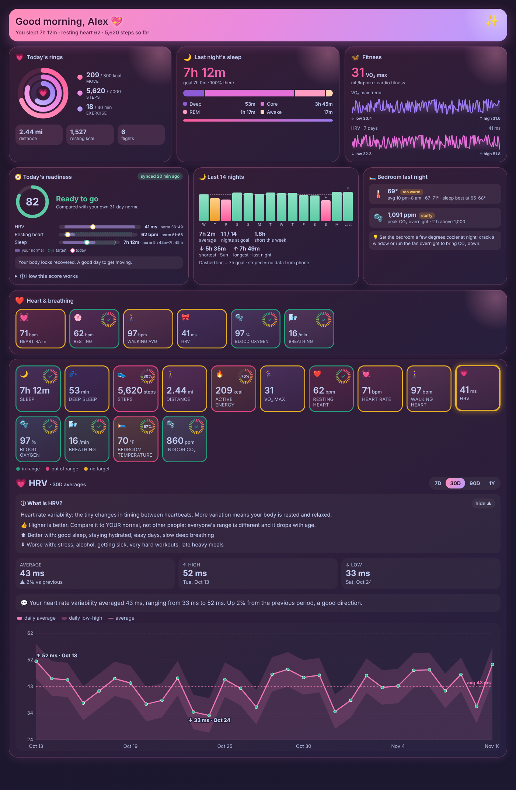

# Apple Health Dashboard

A Home Assistant dashboard card for your **Apple Health** data. It turns the Health sensors from the Home Assistant **iPhone Companion app** into one page you can read at a glance: readiness, activity rings, sleep, heart and breathing, goals, and a big trend graph with highs, lows and averages.

> **Apple Health only.** This card needs an iPhone running the Home Assistant Companion app with its Apple Health sensors turned on. It does not work with Android, Fitbit or Garmin data.



## What you get

- **Readiness score** from HRV, resting heart rate and sleep, compared with your own 30-day normal. Works with any Apple Watch.
- **Rings, sleep and fitness** at the top, with sleep stages and VO₂ max.
- **A card for every metric**, with a colored ring: green = in range, red = out of range, yellow = no target. Cards with a goal get a tick dial showing how close you are.
- **One big trend graph** (7 days, 30 days, 90 days or 1 year) with the target band, daily low–high, average line, and the high and low labeled with their dates.
- **Plain-English "What is this?"** for every metric: what it is, what's good, what makes it better or worse.
- **Optional bedroom sensors:** add a temperature and/or CO₂ sensor to see how your room affected your sleep.
- Light and dark themes follow your Home Assistant theme.



## Requirements

- Home Assistant 2024.1 or newer.
- The [Home Assistant Companion app](https://companion.home-assistant.io/) on your iPhone, with its Apple Health sensors turned on. Your sensors will look like `sensor.<phone>_heart_rate`, `sensor.<phone>_sleep_duration`, `sensor.<phone>_health_steps`.
- An Apple Watch gives the most data (heart rate, HRV, sleep stages, blood oxygen). Without one, cards for missing sensors are simply hidden.
- The recorder must keep long-term statistics for these sensors (the default).

## Install

### HACS

1. Open **HACS** in Home Assistant and search for **Apple Health Dashboard**.
2. Download it, then reload your browser.

### Manual

1. Download `apple-health-dashboard.js` from the [latest release](../../releases/latest).
2. Copy it to `config/www/`.
3. Add it under **Settings → Dashboards → ⋮ → Resources** as `/local/apple-health-dashboard.js`, type **JavaScript module**.

## Add the card

```yaml
type: custom:apple-health-dashboard
phone: my_iphone            # required: the start of your Health sensor names
name: Alex                  # optional: shown in the greeting
bedroom_temperature: sensor.bedroom_temperature   # optional
bedroom_co2: sensor.bedroom_co2                   # optional
```

The card is designed to fill a full-width dashboard view (for example a **Panel** or **Sections** view).

### Options

| Option | Required | Default | What it does |
| --- | --- | --- | --- |
| `phone` | Yes | — | Your iPhone's name as it appears in its sensors. For `sensor.my_iphone_heart_rate`, use `my_iphone`. |
| `name` | No | none | Your name for the greeting ("Good morning, Alex"). |
| `bedroom_temperature` | No | none | A bedroom temperature sensor (°F or °C). |
| `bedroom_co2` | No | none | A bedroom CO₂ sensor in ppm. |
| `steps_goal` | No | `7000` | Daily steps goal. |
| `move_goal` | No | `300` | Daily active calories goal (kcal). |
| `exercise_goal` | No | `30` | Daily exercise minutes goal. |
| `sleep_goal` | No | `420` | Nightly sleep goal in minutes (420 = 7 hours). |

**Optional style:** create a toggle helper named `input_boolean.steampunk_style` and turn it on for a brass-and-gears look.

## Not medical advice

This card shows wellness data for your own information. It is not a medical device and does not diagnose anything. Targets are general guidelines; talk to your doctor about your own numbers.

## Problems or ideas

Open an [issue](../../issues) with a screenshot and your Home Assistant version.
